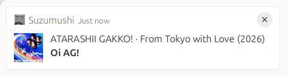

# suzumushi

[](https://github.com/buithehoa/suzumushi/actions/workflows/tests.yml)

Suzumushi shows desktop notifications for Spotify music playing on any of your account's devices. It runs in the background as a systemd user service.



## Installation

Run the commands below from the repository root in your desktop terminal.

### 1. Install prerequisites and the script

Requirements: Python 3.10 or newer, Python virtual environment support, `notify-send`, and a Spotify Developer app.

On Ubuntu/Debian:

```bash
sudo apt install python3-venv libnotify-bin
```

On Arch Linux, install `python` and `libnotify` instead.

```bash
mkdir -p ~/.local/share/suzumushi
python3 -m venv ~/.local/share/suzumushi/.venv
~/.local/share/suzumushi/.venv/bin/pip install -r requirements.txt
install -m 0755 suzumushi.py ~/.local/share/suzumushi/suzumushi.py
```

### 2. Configure Spotify credentials

Register `http://127.0.0.1:8888/callback` as a redirect URI in your Spotify Developer app.

Create a private environment file and edit it with your client ID and secret:

```bash
install -d -m 0700 ~/.config/suzumushi
install -m 0600 .env.example ~/.config/suzumushi/environment
nano ~/.config/suzumushi/environment
```

The file should contain:

```bash
SPOTIPY_CLIENT_ID='your-client-id'
SPOTIPY_CLIENT_SECRET='your-client-secret'
SPOTIPY_REDIRECT_URI='http://127.0.0.1:8888/callback'
```

Keep this file private. The script reads environment variables; systemd will load this file using the configuration below.

### 3. Authorize your Spotify account

```bash
set -a
source ~/.config/suzumushi/environment
set +a
~/.local/share/suzumushi/.venv/bin/python ~/.local/share/suzumushi/suzumushi.py --auth
```

Open the printed URL and approve access. Copy the entire redirected URL from your browser's address bar and paste it into the terminal. A connection error on the callback page is expected. Authorization is saved for future runs; repeat this step if access is revoked.

### 4. Enable the background service

```bash
mkdir -p ~/.config/systemd/user
install -m 0644 systemd/spotify-notifier.service ~/.config/systemd/user/spotify-notifier.service
mkdir -p ~/.config/systemd/user/spotify-notifier.service.d
cat > ~/.config/systemd/user/spotify-notifier.service.d/environment.conf <<'EOF'
[Service]
EnvironmentFile=%h/.config/suzumushi/environment
EOF
systemctl --user import-environment \
  DISPLAY WAYLAND_DISPLAY XAUTHORITY DBUS_SESSION_BUS_ADDRESS XDG_RUNTIME_DIR XDG_CACHE_HOME
systemctl --user daemon-reload
systemctl --user enable --now spotify-notifier.service
```

The service starts automatically at login. Run it as your desktop user, without `sudo`.

## How it runs

- Checks immediately at startup and notifies if music is playing.
- Displays album art, `Artist · Album (Year)` as the heading, and the track title in bold beneath it.
- Waits for the current song's remaining duration before checking again. Skips and pauses are detected at that next check; tracks played entirely between checks can be missed.
- Waits two minutes when playback is paused or idle, or the content is unsupported. Podcasts and advertisements do not produce notifications.
- Avoids repeat notifications for the same track during a run. Restarting the service allows a fresh notification for the current track.

Banner appearance and display duration are controlled by your desktop's notification settings.

Check status and follow logs:

```bash
systemctl --user status spotify-notifier.service
journalctl --user -u spotify-notifier.service -f
```

Restart after changing credentials, or stop the service:

```bash
systemctl --user restart spotify-notifier.service
systemctl --user stop spotify-notifier.service
```

To update the installed script after pulling changes, repeat the dependency installation and script copy from step 1, then restart the service.
